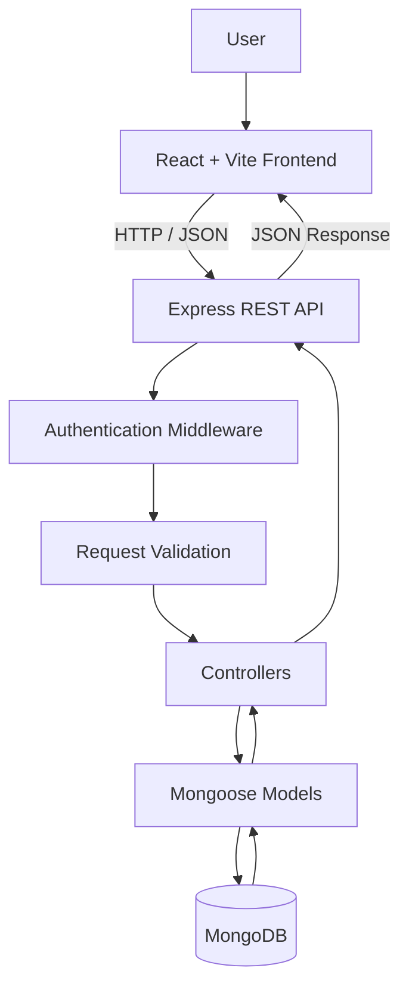

# TaskFlow — Smart Task Management App

A modern, full-stack task management application built to help users organize daily work, manage deadlines, prioritize tasks, and track productivity through a clean, responsive dashboard.

TaskFlow combines a React and Vite frontend with a Node.js and Express REST API, MongoDB persistence, JWT authentication, and a polished interface with persistent dark and light themes.

**Built as a full-stack developer portfolio project** to demonstrate practical skills in frontend development, REST API design, authentication, database integration, and application security.

## Features

### Task Management

- Create, view, edit, and delete tasks.
- Mark tasks as completed or reopen them.
- Set task priorities: Low, Medium, and High.
- Organize tasks into Work, Study, Personal, and Other categories.
- Set due dates and track deadlines.
- Search tasks by keyword.
- Filter tasks by status, priority, and category.
- Sort tasks by due date, creation date, or priority.
- Navigate through paginated task lists.

### Dashboard & Productivity

- Dashboard with task statistics and productivity summaries.
- Task overview with status and priority indicators.
- Responsive layouts for desktop and mobile screens.
- Loading, error, and empty states.
- Toast messages for user feedback.

### Notifications

- In-app notification dropdown for pending tasks due today or overdue.
- Unread notification indicator.
- Mark notifications as read.
- Read-notification state persisted in browser local storage.

*Note: Notifications are derived from the tasks currently loaded by the application; this is not a server-side reminder or push-notification service.*

### User Experience

- Modern SaaS-inspired dashboard interface.
- Dark and light themes.
- Theme preference persisted across browser refreshes.
- Interactive controls and intuitive navigation.
- Icons powered by Lucide React.

### Authentication & Security

- User registration and login.
- JWT-based authentication.
- Protected task-management endpoints.
- User-specific task access.
- Request validation using Express Validator.
- Authentication rate limiting.
- Security headers using Helmet.
- Environment-based configuration.
- MongoDB integration using Mongoose.

## Tech Stack

| Technology            | Purpose                              |
| --------------------- | ------------------------------------ |
| React                 | Frontend UI                          |
| Vite                  | Development server and build tooling |
| Tailwind CSS          | Styling and responsive layouts       |
| Node.js               | Backend runtime                      |
| Express.js            | REST API and routing                 |
| MongoDB               | Database                             |
| Mongoose              | Database modeling and queries        |
| JSON Web Tokens (JWT) | Authentication                       |
| Axios                 | HTTP requests                        |
| React Router          | Client-side routing                  |
| React Hot Toast       | User feedback                        |
| Lucide React          | Icons                                |
| Express Validator     | Request validation                   |
| Helmet                | HTTP security headers                |
| Git & GitHub          | Version control                      |

## Application Architecture



## Project Structure

```text
taskflow/
├── client/
│   ├── public/
│   ├── src/
│   │   ├── assets/
│   │   ├── components/
│   │   ├── App.jsx
│   │   └── main.jsx
│   ├── package.json
│   └── vite.config.js
├── server/
│   ├── config/
│   ├── controllers/
│   ├── middleware/
│   ├── models/
│   ├── routes/
│   ├── server.js
│   └── package.json
├── .gitignore
├── package.json
├── package-lock.json
├── .env.example
└── README.md
```

*This tree highlights the main project files. Additional files may exist in individual directories.*

## Getting Started

### Prerequisites

Install the following tools before running TaskFlow:

- [Node.js](https://nodejs.org/) — preferably a supported LTS release.
- npm — included with Node.js.
- [MongoDB Community Server](https://www.mongodb.com/try/download/community) or a MongoDB Atlas database.
- [Git](https://git-scm.com/).

### 1. Clone the Repository

```bash
git clone https://github.com/junkarnaim/taskflow.git
cd taskflow
```

### 2. Install Dependencies

From the project root, install the root, frontend, and backend dependencies:

```bash
npm run install:all
```

### 3. Configure Environment Variables

Create a `.env` file inside the `server` directory. Check the backend configuration and `.env.example` for the exact environment variable names.

A typical configuration may look like this:

```env
PORT=5001
MONGO_URI=mongodb://127.0.0.1:27017/taskflow
JWT_SECRET=replace_with_a_long_random_secret
```

Use the variable names expected by your actual backend configuration. Generate a strong, unique JWT secret.

**Security:** Never commit real credentials, database passwords, or JWT secrets to GitHub.

### 4. Start MongoDB

If using a local MongoDB installation, ensure the database service is running before starting TaskFlow.

If using MongoDB Atlas, configure your database connection string in the server environment file.

### 5. Run the Application

From the project root:

```bash
npm run dev
```

Typical local addresses:

| Service      | URL                                                                  |
| ------------ | -------------------------------------------------------------------- |
| Frontend     | [http://localhost:5173](http://localhost:5173)                       |
| Backend API  | [http://localhost:5001](http://localhost:5001)                       |
| Health check | [http://localhost:5001/api/health](http://localhost:5001/api/health) |

The health-check endpoint can help verify that the backend is responding.

### 6. Build for Production

Build the frontend from the project root:

```bash
npm run build
```

The production frontend build is generated in `client/dist`.

Configure backend hosting, environment variables, database connectivity, and frontend API settings according to your deployment environment.

## API Overview

All task-management endpoints require valid authentication.

### Authentication

| Method | Endpoint             | Purpose                                       |
| ------ | -------------------- | --------------------------------------------- |
| POST   | `/api/auth/register` | Register a user                               |
| POST   | `/api/auth/login`    | Authenticate a user                           |
| GET    | `/api/auth/me`       | Retrieve the authenticated user's information |

### Tasks

| Method | Endpoint                | Purpose            |
| ------ | ----------------------- | ------------------ |
| GET    | `/api/tasks`            | Retrieve tasks     |
| POST   | `/api/tasks`            | Create a task      |
| PUT    | `/api/tasks/:id`        | Update a task      |
| PATCH  | `/api/tasks/:id/status` | Change task status |
| DELETE | `/api/tasks/:id`        | Delete a task      |

The task-listing endpoint supports search, filtering, sorting, and pagination according to the backend implementation.

### Health Check

| Method | Endpoint      | Purpose                    |
| ------ | ------------- | -------------------------- |
| GET    | `/api/health` | Check backend availability |

## Security Practices

TaskFlow incorporates several backend security measures:

- JWT authentication for protected endpoints.
- Request validation.
- Authentication rate limiting.
- Helmet security headers.
- Environment variables for sensitive configuration.
- User-specific task access.

For production deployment, use HTTPS, secure secret management, restrictive CORS settings, and a properly secured database.

## Development Workflow

Run the full development environment:

```bash
npm run dev
```

Run frontend linting:

```bash
npm run lint --prefix client
```

Build the frontend:

```bash
npm run build
```

Check the Git working tree:

```bash
git status
```

## Testing Checklist

The following workflows have been manually tested during development:

- [x] User registration and login.
- [x] Creating tasks.
- [x] Editing tasks.
- [x] Completing and reopening tasks.
- [x] Deleting tasks.
- [x] Searching and filtering tasks.
- [x] Task persistence after a browser refresh.
- [x] Frontend production build.
- [x] Dark and light theme implementation.

The notification dropdown has been added and the frontend production build passes. Verify its interactions in the browser before marking notification behavior as fully tested.

Automated frontend and backend test coverage can be added as the project evolves.

## Future Improvements

- [ ] Automated unit and integration tests.
- [ ] Server-side scheduled reminders and push notifications.
- [ ] Calendar-based task planning.
- [ ] Team workspaces and collaboration.
- [ ] Advanced productivity analytics.
- [ ] Live demo and production deployment.
- [ ] Further accessibility improvements.

## What I Learned

Developing TaskFlow provides practical experience with:

- Building reusable React components.
- Managing UI state and asynchronous operations.
- Connecting a frontend to a REST API.
- Designing Express routes, controllers, and middleware.
- Implementing JWT-based authentication.
- Modeling and querying MongoDB data using Mongoose.
- Validating incoming requests and applying backend security controls.
- Building responsive interfaces with Tailwind CSS.
- Managing code changes using Git and GitHub.

## Author

**Junkar Naim**

- GitHub: [@junkarnaim](https://github.com/junkarnaim)
- LinkedIn: [Junkar Naim](https://www.linkedin.com/in/junkar-naim-14773a249/)

## License

This project is intended for learning and portfolio demonstration. Add a `LICENSE` file if you decide to distribute it under a specific open-source license.
