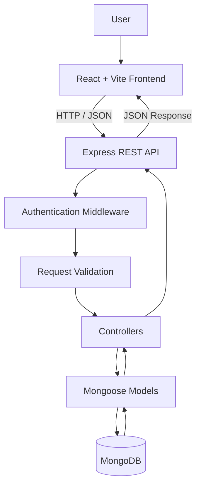

# TaskFlow — Smart Task Management App

A modern, full-stack task management application designed to help users organize their daily work, prioritize tasks, track deadlines, and improve productivity through a clean, responsive dashboard.

TaskFlow combines a React-based frontend with a Node.js and Express backend, MongoDB persistence, and JWT-based authentication.

**Built to demonstrate practical full-stack development skills, REST API design, authentication, database integration, and responsive UI development.**

## Features

### Task Management
- Create, view, edit, and delete tasks.
- Mark tasks as completed or reopen them when needed.
- Assign priorities: Low, Medium, and High.
- Organize tasks into Work, Study, Personal, and Other categories.
- Set due dates and manage deadlines.
- Search tasks by keyword.
- Filter tasks by relevant criteria.
- Sort tasks by due date, creation date, or priority.
- Navigate tasks using pagination.

### Dashboard & User Experience
- Dashboard with task overview and productivity statistics.
- Modern task management interface.
- Responsive layouts for desktop and mobile screens.
- Clear task status, priority, and category indicators.
- Loading, error, and empty states.
- Toast notifications for user feedback.

### Authentication & Security
- User registration and login.
- JWT-based authentication.
- Protected task management API endpoints.
- User-specific task access.
- Request validation using Express Validator.
- Authentication rate limiting.
- Security headers with Helmet.
- Environment-based configuration.
- MongoDB integration using Mongoose.

## Tech Stack

| Technology | Purpose |
|---|---|
| React | Frontend UI |
| Vite | Development server and build tooling |
| Tailwind CSS | Styling and responsive UI |
| Node.js | Backend runtime |
| Express.js | REST API and routing |
| MongoDB | Database |
| Mongoose | Database modeling |
| JSON Web Tokens (JWT) | Authentication |
| Axios | HTTP requests |
| React Router | Client-side routing |
| React Hot Toast | Notifications |
| Lucide React | Icons |
| Express Validator | Request validation |
| Helmet | HTTP security headers |
| Git & GitHub | Version control |

## Architecture



## Project Structure

```text
taskflow/
├── client/
│   ├── public/
│   ├── src/
│   │   ├── assets/
│   │   ├── components/
│   │   ├── App.jsx
│   │   └── main.jsx
│   ├── package.json
│   └── vite.config.js
├── server/
│   ├── config/
│   ├── controllers/
│   ├── middleware/
│   ├── models/
│   ├── routes/
│   ├── server.js
│   └── package.json
├── .gitignore
├── package.json
├── package-lock.json
├── .env.example
└── README.md
```

*Note: The tree illustrates the main project structure. Some directories may contain additional files or may be absent in a particular checkout.*

## Getting Started

### Prerequisites

Install the following before running TaskFlow:

- [Node.js](https://nodejs.org/) — preferably a supported LTS release.
- npm — included with Node.js.
- [MongoDB Community Server](https://www.mongodb.com/try/download/community) running locally, or a MongoDB Atlas connection.
- [Git](https://git-scm.com/).

### 1. Clone the Repository

```bash
git clone https://github.com/junkarnaim/taskflow.git
cd taskflow
```

### 2. Install Dependencies

Install the root, frontend, and backend dependencies using the project's installation script:

```bash
npm run install:all
```

### 3. Configure Environment Variables

Create a `.env` file inside the `server` directory, following the variable names used by your backend configuration.

A typical configuration may look like this:

```env
PORT=5001
MONGO_URI=mongodb://127.0.0.1:27017/taskflow
JWT_SECRET=replace_with_a_long_random_secret
```

**Important:** Confirm the exact variable names against the backend source code before running the application. If your project uses a different MongoDB or JWT variable name, use that name instead.

Never commit real credentials, database passwords, or JWT secrets to GitHub.

### 4. Start MongoDB

If you use a local MongoDB installation, make sure the MongoDB service is running before starting the backend.

For MongoDB Atlas, use your connection string in the server environment configuration instead.

### 5. Run the Application

From the project root:

```bash
npm run dev
```

This starts the frontend and backend using the root development script.

Typical local addresses:

- Frontend: http://localhost:5173
- Backend API: http://localhost:5001
- Health check: http://localhost:5001/api/health

The health-check endpoint can be used to verify that the backend is responding.

### 6. Build for Production

Build the frontend:

```bash
npm run build
```

The frontend production build is generated in the client's `dist` directory.

Use the production start script and deployment configuration appropriate for your backend hosting environment.

## API Overview

The backend exposes REST API endpoints for authentication and task management.

### Authentication

| Method | Endpoint | Purpose |
|---|---|---|
| POST | `/api/auth/register` | Register a new user |
| POST | `/api/auth/login` | Authenticate a user |
| GET | `/api/auth/me` | Retrieve the authenticated user's information |

### Tasks

The task endpoints are protected and require valid authentication.

| Method | Endpoint | Purpose |
|---|---|---|
| GET | `/api/tasks` | Retrieve tasks |
| POST | `/api/tasks` | Create a task |
| PUT | `/api/tasks/:id` | Update a task |
| DELETE | `/api/tasks/:id` | Delete a task |

The task listing API supports task search, filtering, sorting, and pagination according to the backend implementation.

### Health Check

| Method | Endpoint | Purpose |
|---|---|---|
| GET | `/api/health` | Check backend availability |

*API paths and methods should be kept in sync with the actual server routes as the project evolves.*

## Security Practices

TaskFlow uses several backend security measures:

- JWT authentication for protected endpoints.
- Validation of incoming request data.
- Rate limiting for authentication requests.
- Helmet security headers.
- Environment variables for sensitive configuration.
- User-specific access to task data.

For production deployment, use HTTPS, secure secret management, appropriate CORS restrictions, and a properly secured database.

## Development Workflow

Run the development environment:

```bash
npm run dev
```

Run the frontend linter:

```bash
npm run lint --prefix client
```

Build the frontend:

```bash
npm run build
```

## Testing Checklist

The following core workflows have been manually tested during development:

- [x] User registration and login.
- [x] Creating tasks.
- [x] Editing tasks.
- [x] Completing and reopening tasks.
- [x] Deleting tasks.
- [x] Searching and filtering tasks.
- [x] Persisting tasks after a browser refresh.
- [x] Frontend linting and production build.

Automated unit and integration test coverage should be documented separately once implemented.

## Future Improvements

- [ ] Automated backend and frontend tests.
- [ ] Task reminders and deadline notifications.
- [ ] Calendar-based task planning.
- [ ] Team workspaces and collaboration.
- [ ] Advanced analytics and productivity reports.
- [ ] Deployment with a live demo.
- [ ] Additional accessibility and UI refinements.

## What I Learned

Developing TaskFlow provides practical experience with:

- Building reusable React components.
- Connecting a frontend to a REST API.
- Designing Express routes and controllers.
- Implementing JWT authentication.
- Modeling and querying MongoDB data with Mongoose.
- Validating requests and applying backend security controls.
- Managing application state and asynchronous operations.
- Using Git and GitHub to manage project changes.

## Author

**Junkar Naim**

- GitHub: [@junkarnaim](https://github.com/junkarnaim)
- LinkedIn: [Junkar Naim](https://www.linkedin.com/in/junkar-naim-14773a249/)

## License

This project is available for learning and portfolio demonstration. Add a `LICENSE` file if you intend to distribute it under a specific open-source license.

---

If you find this project useful, consider giving the repository a star!
